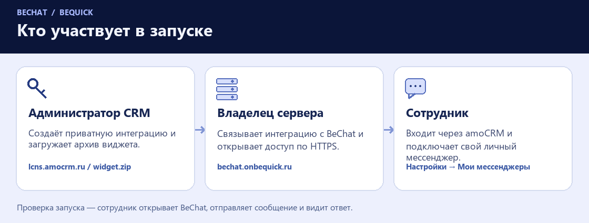

# BeChat от BeQuick

**BeChat 1.1.0** объединяет переписку сотрудников в карточках amoCRM, браузере и приложении для iPhone. В рабочей сборке база изначально пуста. Каждый сотрудник входит через свою учётную запись **lcns.amocrm.ru**. Для развёртывания выделен адрес **bechat.onbequick.ru**.

[Скачать релиз BeChat 1.1.0](https://github.com/trofimyurievich/BeChat/releases/tag/v1.1.0)

На момент выпуска контейнер BeChat запущен на сервере Mysterious Macaw в Timeweb Cloud. Откройте [рабочий адрес BeChat](https://bechat.onbequick.ru). Пока администратор amoCRM оформляет приватную интеграцию, здесь отображается страница подключения. [Состояние процесса](https://bechat.onbequick.ru/livez) · [Готовность входа](https://bechat.onbequick.ru/healthz)

| Файл в релизе | Кому передать | Для чего он нужен |
| --- | --- | --- |
| **BeChat-Server-1.1.0.zip** | Администратору Timeweb | Сервер, веб-клиент, база SQLite при запуске, настройки Docker и инструкции |
| **widget.zip** | Администратору amoCRM | Добавляет BeChat в карточки контактов и сделок |
| **BeChat.ipa** | Ответственному за iPhone | Приложение для iOS 17+, которое нужно подписать в 3uTools для своего устройства |
| **SHA256SUMS.txt** | Администратору | Контрольные суммы скачанных файлов |

## Учредителю: порядок запуска

1. Попросите администратора amoCRM создать приватную интеграцию **BeChat**, указать `https://bechat.onbequick.ru/auth/callback` и загрузить **widget.zip**. Для этого один раз нужны права администратора CRM. Сотрудникам такие права для переписки не требуются. [Установка виджета и четыре значения для настройки](docs/amoCRM.md)
2. Владелец аккаунта Timeweb предоставляет доступ к панели для развёртывания. На сервере BeChat настраиваются поддомен **bechat.onbequick.ru**, сертификат HTTPS, постоянное хранилище и вход через amoCRM. Проверка запуска — ответ `status: ok` по адресу `https://bechat.onbequick.ru/healthz` и успешный вход из карточки CRM. Подробный порядок действий подходит и для повторного развёртывания. [Установка на Timeweb и резервная копия](docs/server.md)
3. Войдите в amoCRM под **своим** логином. Откройте сохранённую сделку, в правой панели нажмите **BeChat → Открыть переписку**. Роль «Учредитель» привязывается к вашему числовому ID. Администратор CRM и учредитель BeChat могут быть разными людьми.
4. Сотрудники открывают **Настройки → Мои мессенджеры** и подключают рабочие каналы. Для SMS учредитель открывает **Настройки → SMS организации**, выбирает отправителя и подключает согласованный с оператором маршрут. [Инструкции по каждому каналу](docs/channels.md)
5. Передайте пользователям iPhone файл **BeChat.ipa** и инструкцию по локальной подписи. Первый вход проходит на странице amoCRM. [Установка через 3uTools и первый вход](docs/iPhone.md)

## Сотруднику: начать работу

- **В CRM.** Откройте карточку, нажмите «Открыть переписку». Виджет подтверждает, под каким сотрудником вы вошли. Диалог, созданный из карточки, привяжется к ней.
- **В браузере и на iPhone.** Откройте BeChat и нажмите «Войти через amoCRM». Если предложены несколько аккаунтов, выберите **lcns**. Если CRM запросит пароль или второй фактор, введите их на её странице. Отдельный пароль BeChat не создаётся.
- **Проверить отправку.** Попросите коллегу написать в тестовый канал, ответьте и проверьте телефон получателя. Для SMS после подключения учредителем откройте **Новый диалог → SMS** и введите номер с кодом страны.

## Что входит в этот релиз

Прямое подключение личного профиля Telegram, связанного устройства WhatsApp, личного MAX и личной страницы ВКонтакте. Сеанс каждого сотрудника ведёт отдельный клиент на вашем сервере. Единый SMS-аккаунт работает через HTTPS API оператора либо SMPP через собственный Jasmin. Возможны отложенные сообщения, отчёты, рассылки и стоп-лист. В интерфейсе есть тёмная и светлая темы, предпросмотр PDF и DOCX, поиск, архив, закрепления, внутренние заметки и шаблоны. Возможность отвечать на SMS и показываемый получателю отправитель определяются договором с оператором.

Telegram требует API ID вашего приложения. Для личных сообщений ВКонтакте требуется допуск приложения VK ID к Messages API. Клиенты WhatsApp и MAX зависят от совместимости с протоколами мессенджеров. Операторский биллинг и HLR/MNP находятся за рамками версии 1.1.0. В родную ленту amoCRM можно подключить отдельный общий канал. Личные диалоги открываются в виджете BeChat под логином их владельца. [Инструкция для четырёх платформ](docs/channels.md)

## Для разработчика

- `server/` — сервер на Node.js 24, SQLite, вход amoCRM и адаптеры каналов.
- `dist/` — веб-клиент, который обслуживает сервер. Настоящую конфигурацию входа выдаёт работающий сервер.
- `widget/` — исходники приватного виджета amoCRM.
- `ios/` — проект Xcode. Команда на macOS с Xcode: `bash ios/build.sh`. Она создаёт Release для iphoneos/arm64 и проверяет Mach-O перед упаковкой в IPA. Подпись выполняется отдельно.
- `node --test tests/*.test.mjs` проверяет серверные сценарии входа, права и изоляцию каналов. Для локальной сборки архивов используйте `python3 scripts/release.py`.
- Для проверки загрузок в Windows используйте `Get-FileHash .\BeChat.ipa -Algorithm SHA256` и сравните результат со строкой того же файла в SHA256SUMS.txt. Аналогично проверяется серверный архив.

Визуальные примеры в инструкциях используют тестовые данные. На схематических изображениях подписаны поля и действия. Внешний вид интерфейсов amoCRM, платформ и 3uTools может меняться.

