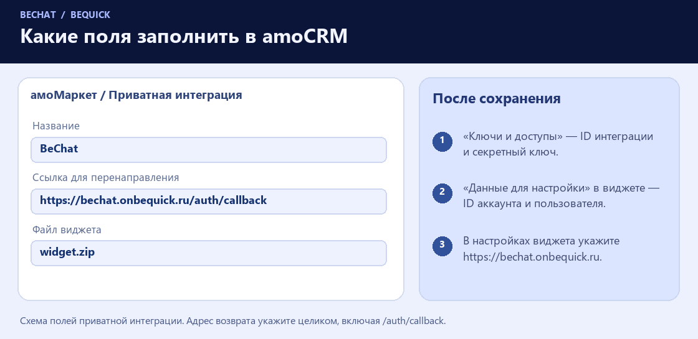

# Подключить BeChat к amoCRM

Эту настройку один раз проходит администратор **lcns.amocrm.ru** вместе с человеком, у которого есть доступ к серверу Timeweb. Сотрудник открывает готовый виджет из карточки клиента.

Для установки и обновления скачайте **widget.zip** версии **1.1.1** с исправленным входом из карточки. [Скачать виджет](https://github.com/trofimyurievich/BeChat/releases/tag/widget-v1.1.1)

Если сейчас у вас обычная учётная запись, перешлите учредителю эту просьбу.

> Пожалуйста, установите приватную интеграцию BeChat в lcns.amocrm.ru под учётной записью администратора и разрешите ей доступ к данным аккаунта. Для сервера нужны ID интеграции, её секретный ключ, числовой ID аккаунта и ID сотрудника, который будет управлять общим SMS-номером. Секрет передадим через корпоративный менеджер паролей. Для ежедневной переписки сотрудники смогут пользоваться своими обычными логинами.

## 1. Создайте карточку интеграции

1. Войдите в **lcns.amocrm.ru**. Проверьте имя аккаунта в адресной строке. Откройте **амоМаркет** в левом меню.
2. Вверху справа нажмите **⋯ → Создать интеграцию**. Выберите **Приватная интеграция**. Введите название **BeChat** и описание «Рабочая переписка BeQuick».
3. В поле **Ссылка для перенаправления / Redirect URI** вставьте `https://bechat.onbequick.ru/auth/callback`. Скопируйте адрес целиком, включая `/auth/callback`.
4. Дайте интеграции доступ к данным аккаунта в соответствии с правами пользователя. Для переписки через собственный сервер BeChat файлы хранятся на нём. Дополнительный доступ к диску amoCRM для этого сценария не нужен.
5. Сохраните карточку. Откройте редактирование интеграции и в поле загрузки виджета выберите **widget.zip** из релиза. Загружайте сам архив с таким именем. Нажмите **Сохранить**.
6. Откройте интеграцию в амоМаркет. Включите её, примите условия, если форма это предлагает. В поле **HTTPS-адрес вашего сервера BeChat** вставьте `https://bechat.onbequick.ru`. Нажмите **Установить** или **Сохранить**.

Если в рабочем аккаунте отсутствует возможность загрузки приватного виджета, попросите владельца аккаунта обратиться в поддержку amoCRM по поводу установки приватной интеграции. Для установки вне технического аккаунта amoCRM описывает процедуру с заявлением клиента. Сначала получите разрешение для нужного аккаунта, затем вернитесь к загрузке. [Создание интеграции](https://www.amocrm.ru/developers/content/oauth/step-by-step) · [Загрузка widget.zip](https://www.amocrm.ru/developers/content/integrations/upload)

## 2. Передайте администратору сервера четыре значения

| Что нужно | Где взять | Куда попадёт |
| --- | --- | --- |
| ID интеграции | Карточка BeChat → «Ключи и доступы» → ID интеграции, строка с дефисами | `AMO_CLIENT_ID` |
| Секретный ключ интеграции | Там же → «Секретный ключ» | `AMO_CLIENT_SECRET` |
| Числовой ID аккаунта | Откройте сохранённую сделку или контакт → блок BeChat → «Данные для настройки» | `AMO_TENANT_ID` |
| Числовой ID учредителя | Сам учредитель открывает тот же блок под своим логином и читает «Мой ID в amoCRM» | `BECHAT_FOUNDER_ID` |

Передайте секретный ключ через корпоративный менеджер паролей. Администратору нужен секрет интеграции. Сотрудники вводят собственный пароль и код двухфакторной проверки только в amoCRM.

## 3. Проверьте работу из карточки

1. Когда администратор сервера подтвердит, что `https://bechat.onbequick.ru/healthz` показывает `status: ok`, обновите страницу CRM.
2. Откройте сохранённую **сделку** или **контакт**. В правой панели найдите **BeChat → Открыть переписку**. Виджет подтвердит текущего сотрудника автоматически.
3. При первом открытии список может быть пуст. Подключите рабочий канал через шестерёнку **Настройки → Мои мессенджеры**. Создайте диалог из карточки, чтобы сохранить связь с этой сделкой или контактом.
4. Закройте окно и откройте тот же блок ещё раз. Должен появиться привязанный диалог. На телефоне и в самостоятельном веб-приложении доступны все диалоги, которые разрешены этому сотруднику в BeChat.
5. Повторите вход под обычным сотрудником и под учредителем. Только у учредителя пункт **SMS организации** открывает управление номером. Звание администратора в CRM само по себе не назначает роль учредителя.

Первичную установку выполняет администратор CRM. После установки обычные сотрудники могут предоставить доступ для своего входа. В интерфейсе CRM BeChat проверяет одноразовое подтверждение от виджета. В самостоятельном приложении BeChat получает ID сотрудника от API amoCRM после входа. [Одноразовые токены виджета](https://www.amocrm.ru/developers/content/oauth/disposable-tokens) · [Разрешения amoCRM](https://www.amocrm.ru/developers/content/oauth/scopes)

## Если нужен обмен с родной лентой чатов amoCRM

Встроенное окно BeChat работает после установки виджета. Для появления сообщений именно в **родной ленте чатов amoCRM** зарегистрируйте отдельный канал API чатов через поддержку amoCRM. Сборка обслуживает один `scope_id`. На этапе настройки выберите соответствующий общий канал. Для ответов из персональных аккаунтов используйте окно BeChat под логином сотрудника.

1. Передайте поддержке amoCRM название BeChat, ID аккаунта, UUID интеграции, код виджета, контактную почту, изображение канала и шаблон `https://bechat.onbequick.ru/hooks/amo/:scope_id`. Иконка находится в репозитории в файле `channel-icon.svg`.
2. Заполните в серверном `.env` выданные `AMO_CHANNEL_ID`, `AMO_CHANNEL_SECRET`, `AMO_BOT_ID` и `AMO_ACCOUNT_ID`. Последнее поле означает **amojo_id** аккаунта для API чатов. Числовой ID аккаунта для входа хранится отдельно в `AMO_TENANT_ID`.
3. Из каталога с сервером выполните `docker compose run --rm app node server/connect.mjs amo`. Скопируйте выведенный `scope_id` в `AMO_SCOPE_ID`, затем выполните `docker compose up -d --force-recreate app`.
4. Отправьте тестовое сообщение в согласованном общем канале. Проверьте его получателем, затем дайте ответ из родной ленты. Внутренние заметки, задачи и теги BeChat хранятся в BeChat. [Регистрация канала](https://www.amocrm.ru/developers/content/chats/chat-start)

## Если что-то пошло иначе

| Что видите | Что проверить |
| --- | --- |
| BeChat отсутствует в карточке | Виджет установлен именно в lcns, архив называется widget.zip, открыта сохранённая сделка или контакт, страница обновлена. |
| Окно пустое или сервер недоступен | Откройте адрес проверки /healthz. Проверьте DNS и HTTPS для поддомена, затем адрес сервера в настройках виджета. |
| «Подтверждение выдано другому аккаунту или приложению» | Сверьте числовой ID аккаунта, ID и секрет именно этой интеграции, Redirect URI и время на сервере. После исправления откройте виджет заново. |
| Пустой список только в конкретной карточке | Проверьте, что диалог создан из неё или связан с её ID. Сравните со списком в самостоятельном приложении под тем же логином. |
| Сотрудник видит окно входа, хотя CRM открыта | В карточке нажмите «Войти через amoCRM» для повторного подтверждения. В самостоятельном окне выберите аккаунт lcns на странице amoCRM. |

