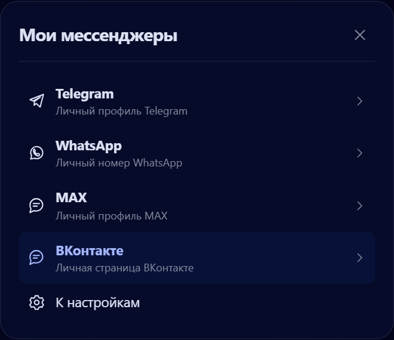
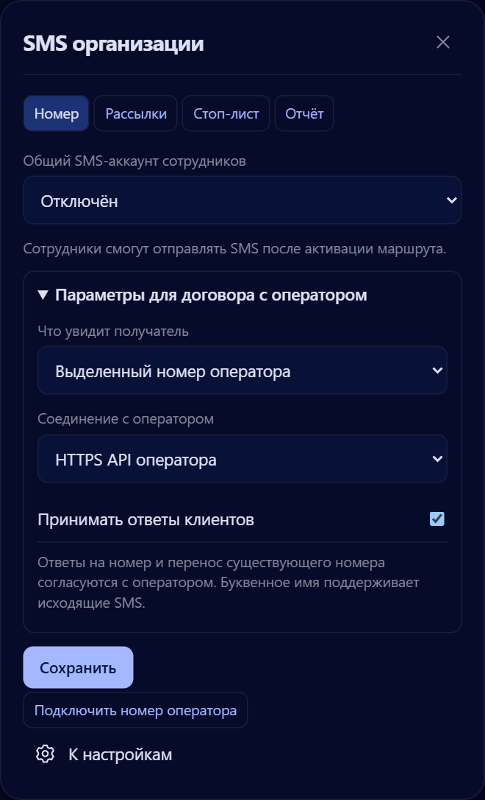

# Каналы сотрудников и общий SMS-номер

## Сотруднику: первое сообщение

1. Откройте BeChat из карточки amoCRM или войдите на **bechat.onbequick.ru**. Внизу слева нажмите шестерёнку **Настройки**. На телефоне сначала вернитесь стрелкой из диалога в список.
2. Выберите **Мои мессенджеры** и нужную платформу. У каждого сотрудника может быть своё подключение каждого из четырёх типов. История персонального канала связана с его ID в CRM.
3. Передайте клиенту адрес бота, номер бизнеса или ссылку на сообщество. Попросите отправить короткое тестовое сообщение. Откройте его в разделе **Входящие**, ответьте и проверьте ответ на устройстве получателя.

### Telegram

1. Откройте в Telegram официальный **@BotFather**, отправьте команду `/newbot`. Укажите название и свободное имя бота. Для существующего рабочего бота используйте его токен.
2. В **Мои мессенджеры → Telegram** вставьте токен и нажмите **Подключить**. BeChat проверит бота и назначит адрес для входящих сообщений. Прежний адрес webhook этого бота будет заменён.
3. С отдельного аккаунта откройте бота, нажмите **Старт** и напишите ему. Бот получает возможность отвечать после первого обращения клиента. Работают текст и документы. [Инструкция BotFather](https://core.telegram.org/bots/tutorial)

### WhatsApp Business

1. Попросите владельца бизнес-аккаунта Meta открыть настройки приложения с продуктом **WhatsApp**. Нужны зарегистрированный номер WhatsApp Business Platform, его **Phone number ID**, версия Graph API, токен с правом отправки `whatsapp_business_messaging` и **App Secret**. Для постоянной эксплуатации используйте подходящий рабочий токен с доступом к этому номеру.
2. Откройте **Мои мессенджеры → WhatsApp**, заполните четыре поля и нажмите **Подключить**. BeChat покажет **Callback URL** и **Verify token** для этого сотрудника.
3. В Meta откройте **WhatsApp → Configuration / Webhooks**, вставьте оба значения и сохраните. Подпишите приложение на поле **messages** и на нужный WhatsApp Business Account (WABA). Проверьте, что другие приложения, использующие этот же webhook, согласованы с администратором.
4. Напишите с разрешённого тестового номера. За пределами окна обслуживания Meta для первого сообщения требуется одобренный шаблон. Для простых шаблонов без параметров администратор добавляет название и язык в `WA_TEMPLATES`, например `[{"name":"hello_world","language":"en_US"}]`, и пересоздаёт контейнер приложения. [Настройка Webhooks Meta](https://developers.facebook.com/docs/graph-api/webhooks/getting-started/) · [WhatsApp Cloud API](https://developers.facebook.com/docs/whatsapp/cloud-api/)

### MAX

1. В кабинете платформы MAX для бизнеса откройте профиль организации, создайте рабочего бота и пройдите его модерацию. В разделе управления ботом получите токен.
2. В **Мои мессенджеры → MAX** вставьте токен и нажмите **Подключить**. BeChat получает данные бота и регистрирует подписку на новые сообщения.
3. Напишите боту из MAX и ответьте в BeChat. Канал поддерживает текстовые ответы. Если сервер не может установить защищённое соединение с доменом API MAX, администратор должен проверить цепочку доверенных сертификатов по документации MAX. [Создание бота](https://dev.max.ru/docs/chatbots/bots-create/create/) · [Управление токеном](https://dev.max.ru/docs/chatbots/bots-create/manage/) · [Подписка на сообщения](https://dev.max.ru/docs-api/methods/POST/subscriptions)

### ВКонтакте

1. Откройте **Управление** своего сообщества и включите сообщения. В разделе **Работа с API → Ключи доступа** создайте ключ сообщества с доступом к сообщениям и настройке Callback API.
2. В **Мои мессенджеры → ВКонтакте** вставьте ключ и нажмите **Подключить**. Скопируйте из BeChat адрес и секрет для обратного вызова.
3. В **Работа с API → Callback API** добавьте сервер. Вставьте адрес и секретный ключ, затем подтвердите сервер. BeChat отвечает кодом подтверждения. В типах событий включите **Входящее сообщение / message_new**.
4. Напишите в сообщество со страницы тестового получателя. Текст появится у сотрудника, подключившего это сообщество. [Схема официального API ВКонтакте](https://github.com/VKCOM/vk-api-schema)

Подключение здесь означает бота, бизнес-номер или сообщество, доступные через официальный API платформы. Вход в обычные потребительские аккаунты мессенджеров по QR в эту версию не входит.

## Учредителю: один SMS-аккаунт для сотрудников

**До выбора оператора** откройте **Настройки → SMS организации → Номер → Параметры для договора с оператором**. Можно сохранить предполагаемую форму отправителя и способ подключения. Чтобы начать реальную отправку, нужен активный маршрут оператора.

| Что увидит клиент | Что спросить у оператора |
| --- | --- |
| Новый выделенный или виртуальный длинный номер | Выдаётся ли отдельный номер? Принимает ли он ответы в нужных сетях? |
| Текущий номер компании | Можно ли включить исходящие и входящие SMS именно для этого номера? |
| Выделенный короткий номер | В каких сетях он работает и как маршрутизируются ответы? |
| Общий короткий номер | Какое ключевое слово должен написать клиент в начале ответа? |
| Зарегистрированное буквенное имя | Как его зарегистрировать и какие сети показывают это имя? Этот вариант предназначен для исходящих SMS. |

**После заключения договора**:

1. Получите подтверждённого отправителя, адрес и описание API, тестовые реквизиты и способ получения отчётов о доставке. При варианте SMPP понадобятся также параметры привязки к SMSC оператора и развёрнутый у вас шлюз Jasmin.
2. Передайте администратору **домен** шлюза. Он впишет домен в `BECHAT_SMS_HOSTS` в серверном .env и применит настройки командой `docker compose up -d --force-recreate app`.
3. Войдите в BeChat **под логином учредителя**, откройте **SMS организации → Номер → Подключить номер оператора**. Введите понятное название, выберите тип отправителя, укажите сам номер или зарегистрированное имя. Укажите приём ответов, если это указано в договоре.
4. **HTTPS API.** Введите адрес метода отправки и токен. При необходимости в разделе «Формат HTTPS API» укажите название заголовка, префикс, JSON и путь к ID в ответе. Доступны подстановки `{to}`, `{from}`, `{text}`, `{id}`. Согласуйте с оператором формат входящих и отчётов, описанный ниже.
5. **SMPP.** Администратор заранее подключает собственный Jasmin к SMSC оператора и настраивает маршруты MT/MO. В BeChat введите HTTPS-адрес метода `/send` вашего Jasmin, имя пользователя и пароль. Для входящих в Jasmin настройте POST на адрес, выданный BeChat. [HTTP API Jasmin](https://docs.jasminsms.com/en/latest/apis/http/index.html)
6. Нажмите **Подключить для сотрудников**. В разделе «Настроить входящие события у оператора» скопируйте адрес и, для HTTPS, секрет подписи. Передайте их администратору, который настраивает обратные вызовы.
7. Войдите под менеджером, нажмите **Новый диалог → SMS**, укажите разрешённый тестовый номер с кодом страны. Отправьте короткий текст. Проверьте телефон получателя и отчёт «Доставлено». Если подключены входящие, ответьте с телефона и проверьте, что сообщение появилось в том же диалоге.

Установку и смену общего номера разрешает сервер только учредителю. Менеджер и администратор отправляют SMS в доступных им диалогах. Наблюдатель может читать. У учредителя также есть «Рассылки», «Стоп-лист» и «Отчёт». Счётчик под полем показывает кодировку и число частей. Часы позволяют отложить отправку. Ответ STOP или СТОП добавляет телефон в стоп-лист.

**Для технического специалиста оператора.** Для HTTPS BeChat принимает POST с JSON и заголовком `X-SMS-Signature: sha256=<hex HMAC-SHA256 от неизменённого тела с выданным секретом>`. Пример полей входящего события: `{"type":"inbound","id":"ID-события","from":"+79990000001","to":"+79990000002","text":"Ответ"}`. Для отчёта: `{"type":"receipt","id":"ID-оператора","status":"delivered"}`. Поддерживаются sent, delivered, failed, expired и unknown. Если оператор присылает другой формат подписи или события, потребуется преобразователь на вашей стороне. Тарификация, HLR/MNP, аренда номеров и голосовые услуги остаются услугами оператора.

## Ежедневная работа

- **Тема.** В шестерёнке «Настройки» нажмите «Светлая» или «Тёмная». Выбор запомнится на этом устройстве.
- **Вложения.** Нажмите имя PDF или DOCX, чтобы прочитать документ. В браузере доступны листание и масштаб, на iPhone используется системный просмотр. Отдельная кнопка «Скачать» сохраняет копию.
- **Чужие диалоги.** Переписку персонального аккаунта видит его владелец. Общие диалоги менеджера ограничены назначенным ответственным. Роли учредителя, администратора и наблюдателя применяются к общей переписке.
- **Отключение канала.** Откройте «Мои мессенджеры», выберите канал, нажмите «Отключить аккаунт» и подтвердите. Обмен через него остановится, история в BeChat сохранится.

