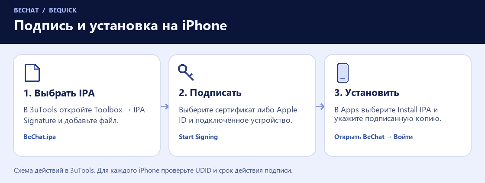

# Установить BeChat на iPhone через 3uTools

Нужен iPhone с **iOS 17 или новее**, Windows-компьютер с 3uTools, кабель для передачи данных и файл **BeChat.ipa** из релиза. Это сборка Release для процессора arm64 физического iPhone. По выбранной схеме сотрудник или администратор подписывает её на своём ПК перед установкой.

1. Скачайте **BeChat.ipa** со страницы релиза на ПК. Подключите iPhone кабелем, разблокируйте и подтвердите **Доверять этому компьютеру**. Дождитесь, пока 3uTools покажет именно ваш телефон.
2. В 3uTools откройте **Toolbox → IPA Signature**. Нажмите **Add IPA File** и выберите BeChat.ipa.
3. Для выбранного варианта нажмите **Sign with Apple ID → Add Apple ID**. Введите Apple ID локально в 3uTools и проверьте выбранное устройство. Если у вашей организации есть сертификат и профиль для этого iPhone, администратор может выбрать подпись сертификатом.
4. Отметьте BeChat в списке и нажмите **Start Signing**. Дождитесь успеха. Нажмите **Open Signed IPA Location**. Для следующего шага используется **файл из этой папки**.
5. В разделе **Apps** устройства выберите **Import & Install IPA** или команду установки IPA вашей версии 3uTools. Укажите подписанный файл. На главном экране iPhone должен появиться **BeChat**.
6. Если iOS запросит доверие разработчику, откройте **Настройки → Основные → VPN и управление устройством** и подтвердите нужный профиль. Для сборки с подписью разработки iOS может запросить **Режим разработчика** в разделе «Конфиденциальность и безопасность» с перезагрузкой. Следуйте сообщению на самом iPhone.
7. Откройте **BeChat → Открыть рабочее пространство**. Адрес по умолчанию уже заполнен: `https://bechat.onbequick.ru`. Шестерёнка вверху позволяет сменить сервер. Ввести нужно адрес BeChat, затем **Войти через amoCRM**. В системном окне выберите рабочий аккаунт **lcns**, при запросе введите ваш обычный пароль amoCRM и код 2FA. После подтверждения iPhone вернёт вас в BeChat.
8. Сравните профиль и список доступных диалогов с BeChat в браузере под тем же логином amoCRM. Для выхода нажмите **Настройки BeChat → Выйти**.

Apple ID нужен при подписи приложения, учётная запись amoCRM — для входа сотрудника. По документации 3uTools у бесплатной подписи Apple ID срок обычно **7 дней**. После истечения потребуется повторная подпись и установка. Для регулярного распространения на зарегистрированные устройства у организации есть вариант Apple Developer Ad Hoc. [Инструкция 3uTools со снимками экранов](https://www.3u.com/tutorial/articles/12092/how-to-use-ipa-sign) · [Профили Apple Ad Hoc](https://developer.apple.com/help/account/provisioning-profiles/create-an-ad-hoc-provisioning-profile)

| Ситуация | Действие |
| --- | --- |
| Установка отклонена сразу | Откройте папку результата подписи. Проверьте, что выбран подписанный файл, UDID совпадает с этим iPhone и версия iOS поддерживается. |
| Значок появился, приложение перестало открываться через несколько дней | Проверьте срок профиля и повторите подпись для устройства. |
| BeChat открывается, но сервер недоступен | В Safari этого iPhone откройте https://bechat.onbequick.ru/healthz. Учредитель проверяет DNS, сертификат и запущенный сервер. |
| amoCRM выбрала другой аккаунт | Завершите попытку входа и выберите lcns на странице amoCRM. Администратор должен предварительно установить BeChat в этот аккаунт. |

