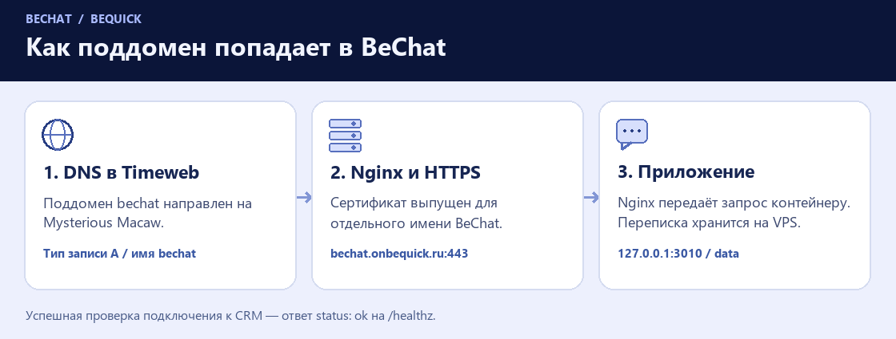

# Развернуть сервер на Timeweb

Для учредителя результат этого шага выглядит так: по адресу **https://bechat.onbequick.ru** появляется кнопка входа через amoCRM. Основной адрес **https://onbequick.ru** продолжает обслуживать личный кабинет BeQuick. Сервер BeChat работает постоянно и хранит данные на диске. На VPS Mysterious Macaw приложение и личные клиенты работают в собственном Docker-проекте с обратным проксированием через Nginx.



**На действующем сервере BeQuick** контейнер BeChat уже развёрнут в `/opt/bechat/app`. Поддомен обслуживает отдельный виртуальный хост Nginx с сертификатом Let's Encrypt. Проверка процесса — `/livez`. Для завершения первичной настройки войдите на VPS после получения реквизитов amoCRM, перейдите в `/opt/bechat/app`, выполните `bash deploy/setup.sh` и `docker compose up -d --force-recreate app`. Мастер сохранит уже созданный ключ хранения. Затем проверьте `/healthz` и вход сотрудника из карточки.

## 1. Подготовьте место для приложения

- В панели Timeweb проверьте тип услуги. Требуется Linux-сервер с возможностью постоянно запускать Node.js 24 или Docker и сохранять SQLite на диске. На обычном тарифе для PHP-сайта сначала уточните у поддержки наличие этих возможностей. Рабочий вариант для этой инструкции — отдельный VPS с Docker Engine и плагином Docker Compose.
- Узнайте публичный IPv4 этого VPS. В панели, которая обслуживает DNS зоны **onbequick.ru**, добавьте запись **A** с именем **bechat** и адресом этого VPS. Корневую запись и запись www оставьте для существующего сайта. Если у поддомена уже есть AAAA, она должна указывать на рабочий IPv6 того же сервиса.
- Откройте входящие TCP 80 и 443 для HTTPS. Конфигурация Caddy из архива рассчитана на выделенные порты на VPS. Если ими уже пользуется веб-сервер, см. отдельный вариант ниже. [Создание сервера Timeweb](https://timeweb.cloud/docs/cloud-servers/manage-servers/create-server) · [Подключение по SSH](https://timeweb.cloud/docs/unix-guides/ssh)

## 2. Загрузите релиз

Скачайте **BeChat-Server-1.1.8.zip** на свой компьютер со страницы релиза GitHub. Передайте архив на VPS через файловый менеджер с SFTP или командой `scp BeChat-Server-1.1.8.zip пользователь@адрес-сервера:~/`. Своё имя и IP берутся из панели Timeweb.

Подключитесь по SSH. Следующие команды выполняются **на VPS** в каталоге вашего пользователя.

```bash
mkdir -p ~/bechat
cd ~/bechat
unzip ~/BeChat-Server-1.1.8.zip
docker compose version
```

После распаковки в этой папке должны лежать `compose.yaml`, `Dockerfile`, `widget.zip` и каталог `deploy`. Сборка контейнера устанавливает библиотеки личных клиентов Telegram, WhatsApp и MAX. Если Docker Compose отсутствует, установите Docker Engine с плагином Compose для своей версии Linux или попросите администратора хостинга сделать это. [Установка Docker Engine](https://docs.docker.com/engine/install/)

## 3. Заполните настройки входа

Сначала получите четыре значения в разделе «Ключи и доступы» и в карточке BeChat. Затем запустите мастер. [Как получить четыре значения](amoCRM.md)

```bash
bash deploy/setup.sh
```

Мастер спросит числовой ID аккаунта, числовой ID учредителя, ID интеграции и её секрет. При вводе секрета символы не отображаются. Мастер создаст файл **.env** с закрытыми правами и отдельным ключом для шифрования аккаунтов мессенджеров. Сохраните его резервную копию в корпоративном хранилище секретов.

Если требуется изменить готовые настройки, откройте `.env` текстовым редактором на сервере. Пустые дополнительные поля можно оставить пустыми.

| Поле | Когда заполнять |
| --- | --- |
| PUBLIC_ORIGIN, AMO_SUBDOMAIN | Для этого релиза уже заданы https://bechat.onbequick.ru и lcns. |
| BECHAT_ADMIN_IDS | Через запятую укажите ID сотрудников, которым разрешено администрировать общую переписку BeChat. |
| BECHAT_OBSERVER_IDS | Через запятую укажите ID сотрудников с доступом к просмотру общих диалогов. Новые активные сотрудники получают роль менеджера. |
| BECHAT_INBOX_OWNER_ID | ID ответственного за новые общие входящие. По умолчанию это учредитель. |
| BECHAT_SMS_HOSTS | Домен API оператора или HTTPS-шлюза Jasmin из договора. Домен с нестандартным портом указывается вместе с портом. |
| AMO_TOKEN | Для дополнительного чтения названия и суммы сделки используется серверный токен администратора с доступом к данным CRM. Запросы выполняются с контекстом конкретного пользователя. Для самого входа это поле не требуется. |

## 4. Запустите и откройте

На VPS, выделенном под BeChat, выполните:

```bash
docker compose --profile edge up -d --build
docker compose ps
curl -fsS https://bechat.onbequick.ru/healthz
```

Приложение запускается с пустой базой. Caddy получит сертификат при работающих DNS и открытых портах. Ответ проверки должен содержать `"service":"BeChat"`, номер версии и `"status":"ok"`. Если сервер сообщает setup_required, приложение доступно по HTTPS и ждёт заполнения четырёх полей amoCRM. После их ввода пересоздайте контейнер app. После этого откройте **https://bechat.onbequick.ru** и нажмите **Войти через amoCRM**. Разрешите доступ в аккаунте lcns.

**Если на VPS уже есть Nginx или другой прокси**, запустите только приложение командой `docker compose up -d --build app`. В существующей панели добавьте отдельный виртуальный хост для bechat.onbequick.ru, HTTPS-сертификат для него и обратное проксирование на `http://127.0.0.1:3010`. Разрешите тело запроса не менее 8 МБ, передавайте исходный Host и заголовки авторизации. Не пишите query-параметры OAuth и секретные адреса обратных вызовов в журналы доступа.

Для личных мессенджеров стандартная установка использует указанный в архиве Dockerfile. Для запуска из исходников требуются Node.js 24, Python 3.12 и зависимости из `personal/requirements.txt`. Переменная `BECHAT_PYTHON` задаёт абсолютный путь к Python.

## 5. Обновление и восстановление

- Служебные сообщения приложения можно посмотреть командой `docker compose logs --tail=80 app`. Если не работает HTTPS на отдельном VPS, проверьте также `docker compose logs --tail=80 proxy`.
- База SQLite живёт в именованном томе **bechat_bechat-data**. Для простой консистентной резервной копии остановите приложение в согласованное окно, скопируйте весь каталог data и запустите его снова. В копию входят папка personal с сессиями устройств и .env с исходным ключом. Ограничьте доступ к резервным копиям так же, как к рабочему VPS. Без него нельзя расшифровать ключи подключённых каналов.
- Для обновления сохраните резервную копию, распакуйте новый релиз в каталог с тем же compose-проектом, сохраните .env и повторите команду запуска. Команда `docker compose down -v` удаляет постоянные тома с перепиской.
- Если импортируете действующую базу старого пилота, сопоставьте предыдущие логины с числовыми ID, прежде чем пускать сотрудников. Например `BECHAT_LEGACY_LOGINS={"12345":"old-manager"}`. Это серверная привязка владельца прежних записей. Пароли предыдущей версии не участвуют во входе. Новая установка обходится без этого поля.
- Сессия BeChat действует до восьми часов. После выхода она отзывается на сервере. Для немедленного отзыва всех активных сессий при кадровом инциденте администратор может остановить приложение и очистить таблицу auth_sessions в рабочей SQLite. Перед ручной операцией сделайте резервную копию.

